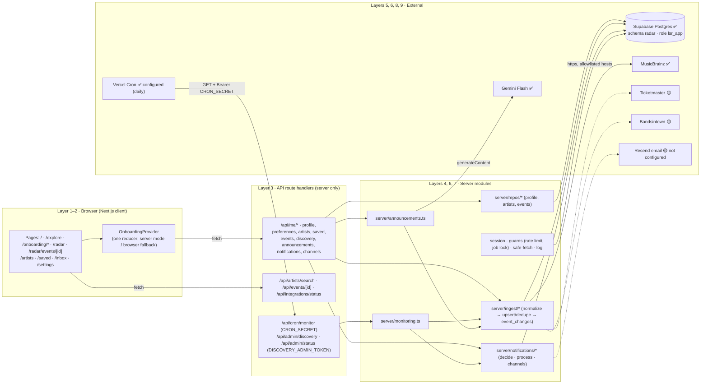
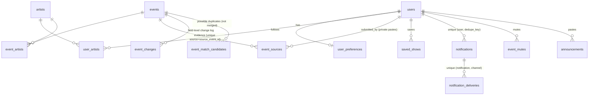

# Live Show Radar: Components Map and Architecture (final, after Part 5)

This document describes **what is actually implemented**. Anything not built is marked **planned**, **blocked** or **not configured**. Every file name below exists in `src/` (or `db/`, `tests/`).

**Status legend:**
- ✅ implemented and verified
- 🟡 implemented but not configured or untested against the live provider
- ⛔ planned or blocked

---

## 1. High-level architecture



**Where secrets live.** Every secret is server-only and read **only** by `src/config/server-env.ts`. That covers `DATABASE_URL`, `SESSION_SECRET`, `GEMINI_API_KEY`, `CRON_SECRET`, `DISCOVERY_ADMIN_TOKEN`, `RESEND_API_KEY` and the provider keys. A build scan confirmed none of them appear in `.next/static`.

**Who calls external providers:**

| Provider | Called from |
|---|---|
| Gemini | `src/integrations/gemini/client.ts` (only), used by `src/server/announcements.ts` |
| MusicBrainz | `src/integrations/musicbrainz/client.ts`, used by `src/integrations/events/musicbrainz.ts`, `src/services/artist-search/musicbrainz-adapter.ts` and `src/server/repos/artists.ts` |
| Ticketmaster / Bandsintown | `src/integrations/events/{ticketmaster,bandsintown}.ts` |
| Resend | `src/server/notifications/channels.ts` |

---

## 2. Layer 1: User experience and route-to-component map

| Route | Layout | Main component(s) | Data source |
|---|---|---|---|
| `/` | `(site)/layout.tsx` | `RadarHero`, `ProductPreview`, `HowItWorks`, `TrustSection` | Static; examples labelled |
| `/explore` | site | `EventCard` × illustrative events | `data/illustrative-events.ts` (fictional, labelled) |
| `/onboarding/artists` → `/location` → `/alerts` (entry is artists; `/onboarding` → `/spotify` only if Spotify is chosen). `/review` and `/status` redirect | `OnboardingFrame` (returning users → `/radar`) | `ArtistSearchStep` (+ `ArtistSearchPanel`), `LocationStep`, `AlertsStep`, `MethodStep`, `SpotifyStep`. Buttons use `features/onboarding/useOnboardingSubmit.ts`: save, then move on; the last step runs `finish.ts` | Provider → `/api/me/*` (flush queued writes; completion via `PUT /api/me/preferences`); search → `/api/artists/search` |
| `/radar` (Discover) | `(app)/layout.tsx` → `AppShell` (top header: nav, artist search, home-city picker) | `RadarDashboard` (ink hero + status, `FilterBar`, sections from `features/discovery/sections.ts`), `AnnouncementIntake`, `EventCard`, `SaveEventButton` | `/api/me/events`, `/api/me/discovery`, `/api/me/announcements`, `/api/integrations/status` |
| `/radar/events/[id]` | app | `EventDetail`, `SourcePanel` | `/api/events/[id]` → saved snapshot → illustrative |
| `/artists` | app | `ArtistsManager`, `ArtistRow`, `ArtistSearchPanel`, `Dialog` | `/api/me/artists*`, `/api/artists/search` |
| `/saved` | app | `SavedShows`, `EventCard` | Profile `savedEvents` |
| `/inbox` | app | `NotificationInbox` | `/api/me/notifications`, `/read`, `/mute` |
| `/settings` | app | `SettingsPage`, `LocationPreferenceSelector`, `AlertPreferenceSelector`, `NotificationChannelList` | `/api/me/preferences`, `/api/me/channels`, `/api/integrations/status` |

## 3. Layer 2: Frontend application

- **Visual system (Part 6 redesign).** Warm editorial tokens in `globals.css` (canvas `#F7F4EC`, white cards, ink `#202820` panels, lime `#C8F169` actions, coral `#FF7058` genuine urgency, plus accessible "ink" text variants). Fraunces for display, Instrument Sans for UI. The radar animation is unchanged.
- **Discovery sections.** `features/discovery/sections.ts` groups the real `/api/me/events` data into: needs attention, just announced, from your artists, tickets available, early bird & presale, coming soon, beyond <home city>. `applyFilters` handles city, date window, artist and genre (from followed artists' tags). Pure functions, unit-tested; empty sections show an empty state, never filler.
- **Routing.** App Router route groups: `(site)` for marketing, `(journey)` for the state provider, `(app)` for `AppShell`. Unknown `/onboarding/*` paths go to a recoverable 404.
- **Shared UI** (`components/ui`): `Button`, `Card`, `TextField`, `SelectField`, `Switch`, `Dialog` (native `<dialog>`), `Toast`, `StatusBadge`, `InlineAlert`, `EmptyState`, `LoadingIndicator`, `Container`, `Eyebrow`.
- **State.** `features/onboarding/OnboardingProvider.tsx` is the single store for the user's radar profile.
  - Server mode works through `server-sync.ts`: an optimistic update, then ordered API calls, then a rollback to the server's copy if any call fails, shown by `SyncErrorBanner`.
  - Browser mode is a localStorage draft, used when server storage isn't configured.
  - A browser draft is imported into an empty server profile once.
- **Data hooks.** `useDiscovery`, `useInbox`/`useUnreadCount`, `useArtistSearch` and `useIntegrationStatus`. They store only fetched results; loading, storage-off and idle are derived, which keeps ESLint's `react-hooks` rules happy.
- **Distinct states.** The dashboard has 9 situations: loading, no artists, storage off, not connected, never checked, request failed, sources failed, no matches, and results (with an outdated flag). The inbox has 4: loading, storage off, error and empty.

## 4. Layer 3: Backend and API

| Route | Method | Guard | Purpose |
|---|---|---|---|
| `/api/me/profile` | GET | read (never creates a profile) | Profile in `OnboardingState` shape |
| `/api/me/import` | POST | write | Browser draft → empty server profile |
| `/api/me` | DELETE | write | Delete profile and clear cookie |
| `/api/me/preferences` | PUT | write, zod | Cities, triggers, method, completion |
| `/api/me/artists`, `/replace` | GET/POST/DELETE, POST | write; server re-derives artists | Follow (idempotent), unfollow, replace |
| `/api/me/saved` | GET/POST/DELETE | write; server loads the event | Saved shows |
| `/api/me/events` | GET | read, zod filters | Events + `DiscoveryReport` |
| `/api/me/discovery` | POST | 4/hour/profile + job lock | Check now, then notifications |
| `/api/me/announcements` | POST | 10/hour/profile, 300/day overall | Gemini extraction |
| `/api/me/notifications`, `/read`, `/mute` | GET, POST, POST | read/write, own rows only | Inbox |
| `/api/me/channels` | GET/PUT | read/write, email validation | Channel settings + real availability |
| `/api/events/[id]` | GET | private events only visible to their owner | Canonical event + evidence |
| `/api/artists/search` | GET | 60/min/IP | MusicBrainz search |
| `/api/integrations/status` | GET | public, no secrets | Configured vs last success for every integration + scheduler |
| `/api/cron/monitor` | GET | `Bearer CRON_SECRET` (constant-time); 503 if unset | Scheduled monitoring |
| `/api/admin/discovery` | POST | `Bearer DISCOVERY_ADMIN_TOKEN` | Manual monitoring run |
| `/api/admin/status` | GET | `Bearer DISCOVERY_ADMIN_TOKEN` | Operator status (aggregates only) |

**Authentication: there is none.** Identity is an **anonymous, signed, httpOnly cookie** (`server/session.ts`). Every user query is filtered by that profile id, and writes require a same-origin request. The limitations, which are documented and deliberate:
- no cross-device access
- clearing cookies loses the profile
- anyone holding the cookie value has that profile

**Shared helpers:** `server/http.ts` (response envelope, JSON size caps, zod validation, safe 500/503), `server/me.ts` (`meRoute` / `meReadRoute`) and `server/guards.ts` (Postgres-backed rate limits and lease locks).

## 5. Layer 4: Data and persistence (Supabase Postgres, schema `radar`)

Migrations live in `db/migrations/` and are applied in order, recorded in `public.lsr_schema_migrations`:

| Migration | What it adds |
|---|---|
| `0001_init.sql` | Base schema |
| `0002_app_role.sql` | Grants and RLS policies for `lsr_app` |
| `0003_private_submissions.sql` | Pasted events stay private to their submitter |
| `0004_notifications.sql` | Notifications, deliveries, mutes, job runs, cursors, channel preferences |



**Operations tables:**
- `ingestion_runs`: per source, per run
- `artist_source_checks`: incremental scheduling
- `job_runs`: monitoring runs
- `job_cursors`: the change-processing cursor
- `job_locks`: leases
- `rate_limits`
- `ai_extractions`: the Gemini cache

**Security:**
- RLS is on for every table, and only the `lsr_app` role has policies.
- The `anon` and `authenticated` roles are revoked, and the schema isn't exposed through Supabase's REST API.
- Supabase's security advisor reports **0 findings**.

## 6. Layer 5: External event sources

| Source | Status | Auth | Normalisation notes | Freshness class | Limits |
|---|---|---|---|---|---|
| MusicBrainz (`integrations/events/musicbrainz.ts`) | ✅ live, real requests | None (User-Agent contact) | Upcoming search per MBID, then an event lookup for the place. Only events that can be placed in India are kept. Time zone `Asia/Kolkata`. Never claims availability | community (details 14 days; tickets never) | 1 req/s queue, 503 backoff. **Very few upcoming Indian shows listed** |
| Ticketmaster (`ticketmaster.ts`) | 🟡 built, not configured, tested only against a mocked API | `TICKETMASTER_API_KEY` | Exact attraction-name match only; `offsale` ≠ sold out | ticketing (tickets 6h) | India coverage unverified |
| Bandsintown (`bandsintown.ts`) | 🟡 built, not configured, tested only against a mocked API | `BANDSINTOWN_APP_ID` (approval needed) | Offers → on sale only when status is `available` | listing | Partner approval required |
| Pasted announcements | ✅ via Gemini | — | Grounded extraction; private to the submitter | user_submitted (never confirms) | — |

**How adapters work.** Every adapter implements `EventSourceAdapter` (`integrations/events/contract.ts`) and is registered in `integrations/events/registry.ts`. One source failing never blocks the others, and failures are recorded as failures, never as empty results.

## 7. Layer 6: AI (Gemini Flash)

- **Client:** `integrations/gemini/client.ts`, using the official `@google/genai` SDK.
  - **Models:** `GEMINI_MODEL` (default `gemini-3.8-flash`), plus an optional `GEMINI_FALLBACK_MODEL` that is always another Gemini model and never another provider.
  - **Reliability:** 25s timeout; 2 retries on 429, 5xx or timeout.
- **Extraction:** `integrations/gemini/announcement-extraction.ts`. One zod schema serves as both Gemini's `responseJsonSchema` and the validator of the reply. The system prompt treats pasted text as untrusted data.
- **Grounding:** `server/announcements.ts` checks the reply against the pasted text:
  - evidence quotes must appear verbatim, and ticket URLs must appear verbatim
  - a date only counts if its year is written
  - early-bird claims need evidence
  - times without an offset get IST only for a confirmed Indian city, and are dropped otherwise
- **Cache:** `ai_extractions`, keyed by prompt version + model + text.
- **Limits:** 10/hour/profile and 300/day overall; input capped at 4,000 characters.
- **Not AI:** matching, deduplication, dates, deadlines and notification decisions are all deterministic code.

## 8. Layer 7: Automation (scheduled discovery, change detection, reminders)

```mermaid
sequenceDiagram
  participant VC as Vercel Cron (daily 01:30 UTC = 07:00 IST)
  participant CR as /api/cron/monitor
  participant MJ as server/monitoring.ts
  participant DP as ingest/pipeline.ts
  participant SRC as Source adapters
  participant UP as ingest/upsert.ts
  participant NP as notifications/process.ts
  participant DE as notifications/decide.ts
  participant DB as Postgres

  VC->>CR: GET (Bearer CRON_SECRET)
  CR->>MJ: runMonitoringJob("schedule")
  MJ->>DB: job_locks lease "monitoring" + job_runs row
  MJ->>DP: runDiscovery(budget 180s, ≤60 artists/source)
  DP->>DB: due artists (artist_source_checks, 6h)
  DP->>SRC: fetchForArtists (per source; failures isolated)
  SRC-->>DP: records / failure
  DP->>UP: normalize → upsert (txn): dedupe, evidence, canonical merge
  UP->>DB: events, event_sources, event_changes
  MJ->>NP: runNotificationPipeline (lease "notifications")
  NP->>DB: event_changes after cursor (job_cursors)
  NP->>DE: classifyChange + decide(per follower)
  DE-->>NP: notify? category, priority, reason, dedupe_key
  NP->>DB: notifications (unique user+dedupe_key) + deliveries
  NP->>NP: processDeadlineReminders (verified deadlines, 72h/24h windows)
  NP->>NP: deliverPending (email, retries with backoff)
  MJ->>DB: job_runs finished (succeeded / partial / failed)
```

- **Change detection.** `upsert.ts` writes field-level `event_changes`, comparing by field type. `classifyChange` keeps only meaningful kinds:
  - new show
  - date changed, venue changed, city changed
  - cancelled, rescheduled
  - ticket status changed, early bird announced, sale date announced

  URL-only edits, information disappearing and conflicts are not alerts.
- **Decision engine** (`decide.ts`), pure and deterministic. It checks in this order:
  1. follows the artist
  2. not muted
  3. not a user-submitted source
  4. not past
  5. location scope (with the out-of-city switch)
  6. trigger enabled
  7. verified and fresh (event details, or ticket facts for ticket alerts)
  8. deadline window

  **Priority** is high only for saved-show changes, verified deadlines, or a new show with a verified open early bird. It never invents scarcity or urgency.
- **Reminders.** Default windows are 72h and 24h. Only the smallest applicable window fires. A reminder needs a verified `earlyBirdEndsAt` with an offset, and deterministic date logic decides whether the deadline has passed.
- **Idempotency and safety:**
  - the cursor plus a unique `dedupe_key` per user
  - one early-bird alert per event
  - leases on monitoring, notifications and discovery per scope; expired leases are taken over
  - all state is in Postgres, so nothing relies on memory between serverless invocations

## 9. Layer 8: Notification delivery

| Channel | Status | Delivery semantics |
|---|---|---|
| In-app inbox | ✅ active whenever server storage works | `delivered` means stored in the user's inbox. Read and unread are separate (`read_at`). Mute works per event |
| Email (Resend) | 🟡 built and tested against a mocked provider; **not configured** (no Resend key). Allowlist-only until double opt-in | `queued` → `sent` (provider accepted, **not** proof of delivery) / `failed` (backoff 5, 10, 20 min; 4 attempts) / `failed_permanent` / `unavailable` (not configured or not allow-listed). Idempotency-Key = delivery id |
| Telegram, push, WhatsApp | ⛔ not built | — |

## 10. Layer 9: Deployment and operations

- **Deployment status:** ✅ https://live-show-radar.vercel.app (production, verified 2026-10-11).
- **Hosting:** Vercel, region `bom1` (Mumbai, next to the database). `vercel.json` holds the region and the daily cron at `30 1 * * *`. On the Hobby plan, cron runs at most once a day with timing anywhere within the hour, and the function limit is 300s; `/api/cron/monitor` sets `maxDuration = 300`.
- **Database:** Supabase project `live-show-radar` (ap-south-1). Deployments use the transaction-mode pooler on `:6543`, with the app using one connection per instance.
- **Operations:**
  - `GET /api/admin/status` (bearer) shows the last scheduled run, last success, running jobs, per-source outcomes, delivery counts by status and the change cursor.
  - `/api/integrations/status` shows public configured vs last-success information, which also appears in Settings.
  - Logs are JSON, with secrets redacted.
- **Environment variables:** documented in `.env.example`. None are needed for the build. The app needs `DATABASE_URL`, `SESSION_SECRET`, `CRON_SECRET` and `DISCOVERY_ADMIN_TOKEN` to run fully; Gemini, MusicBrainz contact, Ticketmaster, Bandsintown and Resend are optional.

## 11. Security boundaries (summary)

- **Server-only secrets:** the client bundle scan was clean, and no secrets are committed (`.env*.local` is git-ignored; I reviewed the diff before pushing).
- **Least-privilege database role and RLS.** The database password was generated locally; Supabase only received a SCRAM hash.
- **Requests:**
  - same-origin checks on writes
  - zod on every input, with body size caps
  - rate limits on search, discovery and AI
- **Outbound and links.** No SSRF surface: only allowlisted https hosts are fetched, and redirects aren't followed. URLs from users or sources are stored and rendered (http/https only), never fetched.
- **Security headers:** nosniff, `X-Frame-Options: DENY`, referrer policy, permissions policy and HSTS (`next.config.ts`).
- **Private data:** pasted events and evidence stay private to the submitter, and the operator status endpoint returns aggregates only.

## 12. Tests (where each guarantee is checked)

| Test file | What it covers |
|---|---|
| `tests/unit/normalize.test.ts` | Time zones, cities, normalisation, merge, change comparison |
| `tests/unit/domain-rules.test.ts` | Freshness, signals and deadlines, dashboard states, reducer, migration |
| `tests/unit/ai-and-validation.test.ts` | Gemini output validation, grounding, API schemas, URL sanitising |
| `tests/unit/adapters.test.ts` | MusicBrainz, Ticketmaster and Gemini client with **mocked** providers |
| `tests/unit/notifications.test.ts` | Classification, decisions, reminders |
| `tests/integration/persistence.test.ts` | Database: preferences, follows, isolation, idempotent ingest, dedupe, privacy, saved shows, partial source failure, leases |
| `tests/integration/notifications.test.ts` | End to end: new show, date change, deadline reminder, no-deadline case, email retry (mocked HTTP), overlapping runs |

Integration tests use **isolated TEST records only** and delete everything afterwards (verified by query).
