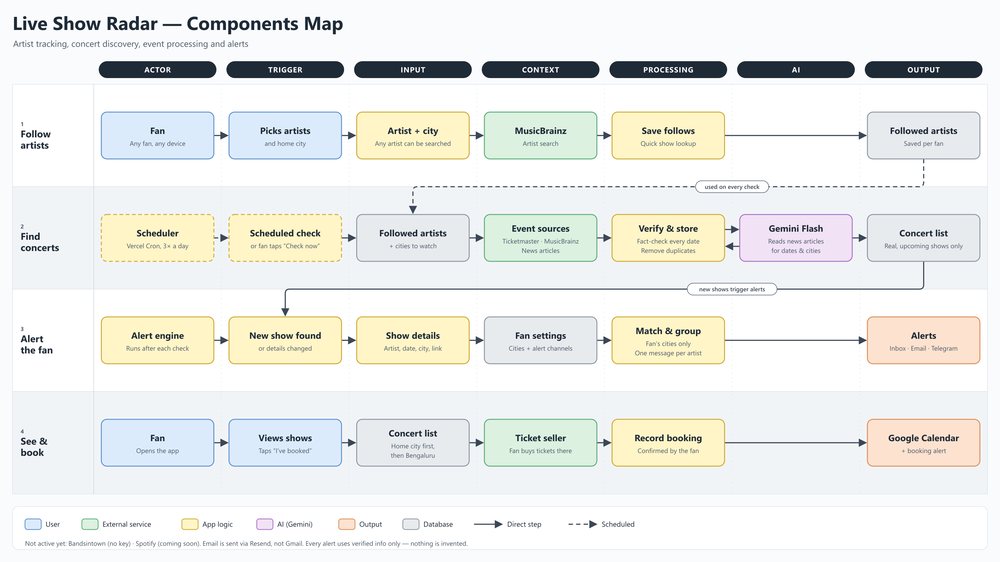

# Live Show Radar — Components Map

This is a high-level map of the app: one box per step, four flows. To regenerate it, run `node scripts/render-components-map.mjs`. That writes the `.svg` and a 3200×1800 `.png` and adds no new dependencies.

**Columns:** Actor → Trigger → Input → Context → Processing → AI → Output.

**Arrows:** a solid arrow is a direct step. A dashed arrow, or a dashed box border, is scheduled.

## The four flows

1. **Follow artists.** A fan picks any artist (searched through MusicBrainz) and a home city. The app saves the follow.
2. **Find concerts.** The scheduler (Vercel Cron, 3 times a day) runs a check. A fan can also run one by tapping "Check now".
   - The check looks up every followed artist in Ticketmaster, MusicBrainz and news articles.
   - Gemini Flash reads the articles and pulls out dates and cities.
   - The app then fact-checks each date and city against the article itself and removes duplicates.
   - Only real, upcoming shows are stored.
3. **Alert the fan.** After each check, new or changed shows are matched to each fan's own cities. Each artist gets one message, sent to the in-app Inbox, email and Telegram.
4. **See & book.** The fan sees shows from their home city first, then Bengaluru, and buys tickets on the seller's site. They then tap "I've booked". The booking is added to Google Calendar, with a booking alert.

## What each box maps to in the code

| Box | Code |
| --- | --- |
| Save follows | `src/app/api/me/artists/route.ts` |
| Scheduler / Scheduled check | `vercel.json`, `src/app/api/cron/monitor/route.ts`, `src/app/api/me/discovery/route.ts` |
| Event sources | `src/integrations/events/` (Ticketmaster, MusicBrainz, news) |
| Verify & store | `src/server/ingest/pipeline.ts`, `src/integrations/gemini/tour-extraction.ts` |
| Gemini Flash | `src/integrations/gemini/client.ts` |
| Match & group / Alerts | `src/server/notifications/` |
| Concert list (city order) | `src/features/discovery/city-focus.ts` |
| Record booking / Google Calendar | `src/server/bookings.ts`, `src/integrations/google/calendar.ts` |
| Database | Supabase Postgres, `db/migrations/` |

## Left out on purpose (to keep it readable)

- **Pasted announcements.** A fan pastes a tour post, Gemini reads it, and the result becomes a private event that only that fan sees.
- **Admin trigger, retries and rate limits.**
- **Static content.** Curated videos and artist photos.
- **Not active yet:**
  - Bandsintown: no API key.
  - Spotify: shown as "coming soon".
- **Gmail:** not used. Email goes through Resend.
